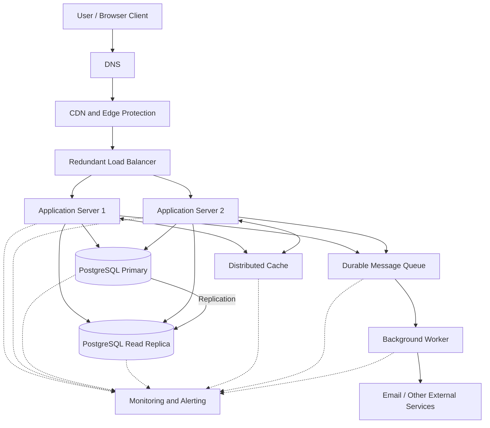

# QuickNotes System Architecture

## 1. Overview

QuickNotes is evolving from a browser-only application into a production online service supporting one million registered users. The proposed architecture separates the client, application services, data storage and background processing so that each layer can scale independently.

The system uses a stateless application tier, a distributed cache, PostgreSQL with a read replica, and a message queue for asynchronous work. A load balancer distributes traffic across multiple application servers, while monitoring, health checks, backups and redundancy improve reliability.

The browser client currently uses JSONPlaceholder for demonstration purposes. In production, it will communicate with the authenticated QuickNotes API described in `api-design.md`, backed by the database schema described in `data-model.md`.

## 2. Functional requirements

The system must support the following functions:

1. Register users and authenticate them securely.
2. Create notes with a required title and optional body.
3. Retrieve a user's notes, including pagination, sorting and filtering.
4. Retrieve, update and delete individual notes.
5. Create and manage tags and associate tags with notes.
6. Enforce user ownership and prevent unauthorized access to private notes.
7. Validate incoming data and return consistent HTTP status codes and error responses.
8. Support asynchronous background work, such as sending account emails, processing audit events and maintaining search indexes.
9. Allow users to access their notes through a browser-based client over HTTPS.

## 3. Non-functional requirements

The following are proposed initial service-level targets. They should be validated through load testing and revised as actual usage becomes known.

| Requirement | Target |
|---|---|
| Availability | 99.9% monthly availability for the API |
| Read latency | p95 below 200 ms for ordinary cached reads |
| Write latency | p95 below 400 ms for ordinary note creation |
| Scalability | Support one million registered users and scale horizontally |
| Security | HTTPS, authenticated access, ownership checks and encryption at rest |
| Data durability | Automated backups and point-in-time recovery |
| Recovery point objective (RPO) | Target of 5 minutes or less |
| Recovery time objective (RTO) | Target of 30 minutes or less |
| Observability | Centralized logs, metrics, traces, alerts and health checks |
| Maintainability | Versioned APIs, automated tests, CI/CD and documented deployment procedures |

Latency targets apply to normal operation, not every request under every failure condition. RPO and RTO are design goals that must be verified through operational recovery tests.

## 4. Capacity and load estimates

### 4.1 Assumptions

The initial planning assumptions are:

- Registered users: 1,000,000.
- Daily active users (DAU): 20% of registered users, or 200,000.
- Reads per active user per day: 20.
- Writes per active user per day: 2 new notes.
- Average stored note size: 2 KB, including typical content and core record metadata but excluding indexes and replicas.
- Peak traffic: 10 times average traffic.
- Time period: 365 days.

These assumptions are estimates, not measured production traffic. Actual workloads may differ because of usage patterns, note lengths, retries, updates, deletes and automated clients.

### 4.2 Reads per second

Daily reads:

\[
200{,}000 \times 20 = 4{,}000{,}000
\]

Average reads per second:

\[
\frac{4{,}000{,}000}{86{,}400}
\approx 46.3
\]

Applying a peak multiplier of 10:

\[
46.3 \times 10 \approx 463
\]

**Planning estimate: approximately 46 average reads per second and 463 peak reads per second.**

### 4.3 Writes per second

Daily new notes:

\[
200{,}000 \times 2 = 400{,}000
\]

Average writes per second:

\[
\frac{400{,}000}{86{,}400}
\approx 4.63
\]

Peak writes per second:

\[
4.63 \times 10 \approx 46.3
\]

**Planning estimate: approximately 4.6 average note-creation writes per second and 46 peak writes per second.**

Updates, deletions, tag operations and background jobs introduce additional database and application traffic. These are not included in the new-note write calculation.

### 4.4 Storage growth per year

Daily raw note storage growth:

\[
400{,}000 \times 2\text{ KB} = 800\text{ MB/day}
\]

Annual raw storage growth:

\[
800\text{ MB} \times 365 = 292{,}000\text{ MB}
\]

Using decimal storage units, this is approximately **292 GB of new raw note data per year**.

For initial infrastructure planning, allow approximately 1.5 times the raw growth for database indexes, record overhead and additional storage requirements:

\[
292\text{ GB} \times 1.5 = 438\text{ GB/year}
\]

This gives an estimated **438 GB per year of primary database storage growth**, excluding read replicas, backups, logs, cached data and other operational overhead.

The estimate assumes new notes accumulate without deletion. Existing users, tags and other metadata add some storage, while retention policies and compression may reduce it. Replication and backup capacity must be budgeted separately.

### 4.5 Capacity planning summary

| Metric | Average estimate | Peak estimate |
|---|---:|---:|
| Read requests per second | 46 | 463 |
| New-note writes per second | 4.6 | 46 |
| Raw note storage growth | 292 GB/year | Not applicable |
| Primary storage planning allowance | 438 GB/year | Not applicable |

The initial architecture should be load-tested above the projected peak and monitored for CPU, memory, database connections, cache hit rate, queue depth and response latency. Scaling decisions should use observed bottlenecks rather than registered-user count alone.

## 5. Proposed architecture diagram

The diagram shows the logical architecture. In production, DNS, load balancing, caching, databases and queue services should be deployed with suitable redundancy. The application servers are stateless so that additional instances can be added without moving user sessions between machines.

## 6. Architecture components and their purposes

### 6.1 Browser client

The browser provides the user interface for creating, viewing, editing and deleting notes. It communicates with the backend over HTTPS and provides immediate validation and feedback without being trusted to enforce security rules.

### 6.2 DNS

DNS resolves the API hostname to the appropriate entry point, allowing clients to use a stable domain even when the underlying infrastructure changes. Redundant DNS infrastructure and health-aware routing reduce dependence on a single resolver or endpoint.

### 6.3 Content delivery network (CDN)

The CDN serves static assets such as JavaScript, CSS, images and other cacheable files from geographically distributed edge locations. It reduces latency and origin traffic; authenticated, user-specific API responses must not be publicly cached.

### 6.4 Load balancer

The load balancer distributes incoming API requests across healthy application servers and performs health checks. A redundant or managed load-balancing service avoids making one physical load-balancer instance a single point of failure.

### 6.5 Application servers

Two or more application servers run the QuickNotes API, validate input, authenticate users, authorize operations and execute business logic. Stateless instances support horizontal scaling and allow unhealthy instances to be removed without taking down the entire service.

### 6.6 Distributed cache

A distributed cache, such as Redis, stores frequently requested data for a short period to reduce repeated database reads and improve latency. Cache keys must include appropriate user or tenant boundaries, and cache invalidation must occur when notes or tags change.

The cache is an optimization rather than the system of record: cache misses and cache outages must not result in lost notes.

### 6.7 PostgreSQL primary database

The primary database stores durable users, notes, tags and note-tag relationships. It enforces relational constraints and transactions and handles authoritative writes, preventing the cache from becoming the source of truth.

### 6.8 PostgreSQL read replica

A read replica receives replicated data from the primary and handles suitable read-only queries, reducing pressure on the primary database. Because replication can be delayed, the application should direct operations requiring immediate read-after-write consistency to the primary.

Automated or orchestrated failover, replication monitoring and tested promotion procedures are required before the replica can be relied on for recovery.

### 6.9 Durable message queue

The queue holds background jobs until workers process them. It decouples API requests from slower tasks such as sending email, processing audit events or rebuilding search indexes, preventing those tasks from unnecessarily increasing user-facing response times.

### 6.10 Background worker

Workers consume queued jobs, execute them independently of web requests and retry transient failures using bounded retry policies and backoff. Jobs should be idempotent where possible, and a dead-letter queue should capture messages that repeatedly fail.

### 6.11 Monitoring and alerting

Centralized monitoring collects application metrics, database health, cache statistics, queue depth, error rates and latency. Alerts notify the engineering team of abnormal conditions, allowing problems to be detected and investigated before they become prolonged outages.

### 6.12 Backups and disaster recovery

Automated database backups and PostgreSQL point-in-time recovery protect against accidental deletion, corruption and infrastructure failures. Backups must be stored separately from the primary failure domain, and restoration procedures must be tested regularly.

## 7. GET /notes request flow

The following steps describe how the production API retrieves a user's notes.

1. The browser sends `GET /v1/notes?limit=10&offset=0` over HTTPS with its access token.
2. DNS resolves the API hostname to the service entry point.
3. The CDN handles applicable static assets and forwards API requests according to its routing policy.
4. The load balancer selects a healthy application server.
5. The application server validates the access token and identifies the authenticated user.
6. The application validates the pagination parameters and verifies that the request is permitted.
7. The server checks the distributed cache using a key scoped to the authenticated user and relevant query parameters.
8. On a cache hit, the server returns the cached result if it is valid and the consistency policy permits its use.
9. On a cache miss, the application retrieves the user's notes from PostgreSQL, using the primary or read replica according to consistency requirements and replica health.
10. The application serializes the authorized result as JSON and may populate the cache with a suitable time-to-live.
11. The API returns `200 OK` with the notes and pagination metadata.
12. Monitoring records latency, status codes and relevant operational metrics without logging sensitive content unnecessarily.

An empty result is a successful request returning `200 OK` with an empty `data` array and appropriate pagination metadata. An unauthenticated request receives `401 Unauthorized`.

## 8. POST /notes request flow

The following steps describe the creation of a note.

1. The browser sends `POST /v1/notes` with an access token and a JSON body containing `title` and optionally `body`.
2. DNS, the CDN routing layer and the load balancer direct the request to a healthy application server.
3. The application validates the token and derives the user's identity from it rather than trusting a client-supplied user ID.
4. The server validates the JSON format, required title, 100-character title limit, payload size and permitted fields.
5. The application opens a database transaction and inserts the note into the PostgreSQL primary database.
6. PostgreSQL validates constraints and commits the transaction. If the operation fails, the transaction is rolled back and an appropriate error is returned.
7. After a successful commit, the application invalidates or updates affected cache entries so stale notes are not served.
8. The application publishes any required background events to the durable queue, preferably using a transactional outbox pattern when reliable publication must be coordinated with the database commit.
9. A worker processes queued tasks, such as sending a confirmation email or updating a search index, independently of the original request.
10. The API returns `201 Created`, the new note representation and a `Location` header identifying the created resource.

The note is considered successfully created only after the database transaction commits. If queue publication is required for correctness, the transactional outbox prevents the database commit and event publication from silently diverging. The API should not return a failed response after committing a note without considering retry behaviour, because a client retry could create a duplicate.

## 9. Trade-offs and design decisions

### 9.1 SQL versus NoSQL

**Decision:** Use PostgreSQL as the primary database.

**Benefits:** Relational constraints, transactions and joins support reliable relationships between users, notes and tags. The data model is straightforward to query and maintain.

**Trade-off:** Relational joins and write contention can become expensive as traffic and data volume grow. The system addresses this through appropriate indexes, connection pooling, query optimization, read replicas and horizontal application scaling. A database migration should be considered only if measured requirements justify its operational complexity.

### 9.2 Caching versus consistency

**Decision:** Use a distributed cache for frequently read data, while keeping PostgreSQL authoritative.

**Benefits:** Cache hits reduce database load and can improve response times for repeated reads.

**Trade-off:** Cached results can become stale, and cache invalidation introduces complexity. Use short, appropriate TTLs, user-scoped cache keys and explicit invalidation on writes. Route read-after-write operations to the primary where immediate consistency is required.

### 9.3 Asynchronous versus synchronous processing

**Decision:** Use a durable queue for non-critical background tasks.

**Benefits:** Slow external services and expensive background operations do not need to delay ordinary API responses.

**Trade-off:** Queue consumers introduce eventual consistency, retries and possible duplicate delivery. Use idempotent jobs, bounded retries, dead-letter handling, queue monitoring and transactional event publication where needed. Note creation itself remains synchronous with the primary database commit.

### 9.4 Read replicas versus additional primary capacity

**Decision:** Introduce a read replica to handle appropriate read traffic.

**Benefits:** Read-heavy workloads can be distributed, preserving primary database capacity for writes.

**Trade-off:** Replication lag means a recent write might not immediately appear on the replica. The application routes consistency-sensitive queries to the primary and monitors replication lag. If write traffic becomes the bottleneck, further database optimization or a carefully planned partitioning strategy may be required.

## 10. Avoiding single points of failure

High availability requires redundancy across the critical infrastructure, not merely running two application servers.

- **DNS and routing:** Use a resilient DNS provider, redundant service endpoints and health-aware routing where available.
- **Load balancing:** Use a managed or redundant load-balancing configuration instead of relying on one self-hosted instance.
- **Application tier:** Deploy at least two stateless application instances across separate availability zones or failure domains. Configure health checks, automatic replacement and autoscaling.
- **Cache:** Use a supported highly available cache configuration, with sensible timeouts and a controlled fallback to PostgreSQL when feasible. Protect the database from a sudden cache-wide miss.
- **Database:** Use a primary and a monitored read replica, with tested failover and promotion procedures. Configure backups and point-in-time recovery independently of replication, since replication can copy accidental changes or deletions.
- **Queue and workers:** Use a durable, replicated queue service and multiple workers. Configure acknowledgements, retries and dead-letter handling so temporary failures do not permanently lose background jobs.
- **External services:** Use timeouts, bounded retries and circuit breakers to prevent slow external dependencies from exhausting application resources.
- **Deployment and monitoring:** Use rolling deployments, health checks, centralized observability and tested incident-response procedures.

A read replica is not, by itself, a complete high-availability solution: it must be possible to promote it safely when the primary fails, and the application must reconnect to the new primary. Likewise, running multiple application servers in the same failure domain does not protect against an outage affecting that entire domain.

## 11. Security considerations

The architecture enforces authentication and authorization at the API layer. Every note query must be scoped to its owner, and tag associations must be checked to ensure that notes and tags belong to the same user.

Additional safeguards include:

- TLS for all external traffic and encrypted database connections.
- Encryption at rest for databases, backups and other sensitive storage.
- Secure password hashing and controlled token lifetimes.
- Managed secrets rather than credentials embedded in source code.
- Request validation, rate limiting and payload-size limits.
- Least-privilege database and service accounts.
- Redaction of access tokens, passwords and sensitive note content from logs.
- Security monitoring, dependency updates and regular access reviews.

The CDN and cache must never bypass API authorization or expose private notes through shared public cache entries.

## 12. Deployment and scaling strategy

Initially, deploy the API across at least two application instances behind the load balancer, with managed PostgreSQL, a read replica, a distributed cache and a durable queue. Keep configuration external to the application code and use a CI/CD pipeline to run tests before deployment.

Scale application servers horizontally as request volume increases. Monitor database CPU, query latency, connection usage, cache hit ratio and replication lag before increasing database capacity or changing the data model. Use load tests that simulate peak traffic and realistic user behaviour.

As the service grows, additional options include read-replica scaling, table partitioning where justified, dedicated search infrastructure and geographically distributed deployments. These additions should be driven by measured bottlenecks rather than introduced prematurely.

## 13. Conclusion

This architecture provides a scalable starting point for a QuickNotes service with one million registered users. Stateless application servers, a load balancer, distributed caching, PostgreSQL replication and asynchronous workers separate responsibilities and allow the service to grow without relying on a single application instance.

The capacity estimates establish an initial planning baseline, while monitoring, load testing, database tuning, automated recovery and clearly defined consistency policies provide a path toward reliable production operation. The design remains intentionally practical: PostgreSQL is the source of truth, the cache is an optimization, and background processing is separated from the synchronous note-creation transaction.