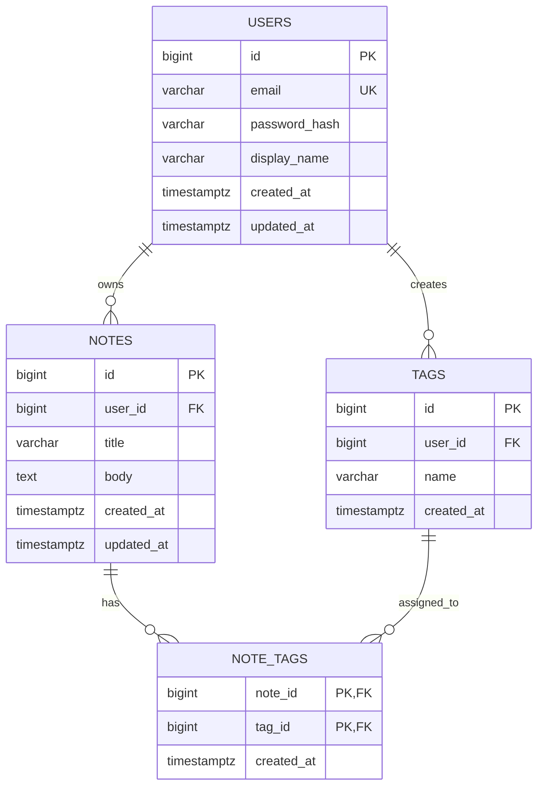

# QuickNotes Data Model

## 1. Overview

QuickNotes uses PostgreSQL as its primary relational database. The data model contains four core entities: `users`, `notes`, `tags` and `note_tags`.

The model supports multiple users, private notes, reusable tags and many-to-many relationships between notes and tags. Primary keys uniquely identify records, while foreign keys enforce relationships between tables.

The database stores timestamps in UTC and uses generated identifiers for records.

## 2. Entity definitions

### 2.1 Users

The `users` table stores account information.

| Column | Type | Constraints | Description |
|---|---|---|---|
| id | BIGINT GENERATED ALWAYS AS IDENTITY | PRIMARY KEY | Unique internal user identifier. |
| email | VARCHAR(255) | NOT NULL, UNIQUE | User's email address. |
| password_hash | VARCHAR(255) | NOT NULL | Secure password hash, never plaintext. |
| display_name | VARCHAR(100) | NOT NULL | User's display name. |
| created_at | TIMESTAMPTZ | NOT NULL, DEFAULT CURRENT_TIMESTAMP | Account creation timestamp. |
| updated_at | TIMESTAMPTZ | NOT NULL, DEFAULT CURRENT_TIMESTAMP | Most recent account update. |

Email addresses must be normalized consistently before storage and uniqueness checks. Passwords should be hashed using a suitable password-hashing algorithm such as Argon2id.

### 2.2 Notes

The `notes` table stores the content created by users.

| Column | Type | Constraints | Description |
|---|---|---|---|
| id | BIGINT GENERATED ALWAYS AS IDENTITY | PRIMARY KEY | Unique note identifier. |
| user_id | BIGINT | NOT NULL, FOREIGN KEY | References the note's owner in `users`. |
| title | VARCHAR(100) | NOT NULL | Note title. |
| body | TEXT | NOT NULL, DEFAULT '' | Optional note body represented by an empty string when omitted. |
| created_at | TIMESTAMPTZ | NOT NULL, DEFAULT CURRENT_TIMESTAMP | Creation timestamp. |
| updated_at | TIMESTAMPTZ | NOT NULL, DEFAULT CURRENT_TIMESTAMP | Last modification timestamp. |

The database requires a non-empty title after trimming whitespace. The application must enforce this rule, and a database constraint should provide an additional safeguard.

### 2.3 Tags

The `tags` table stores labels that users can apply to notes.

| Column | Type | Constraints | Description |
|---|---|---|---|
| id | BIGINT GENERATED ALWAYS AS IDENTITY | PRIMARY KEY | Unique tag identifier. |
| user_id | BIGINT | NOT NULL, FOREIGN KEY | References the tag's owner in `users`. |
| name | VARCHAR(50) | NOT NULL | Tag name. |
| created_at | TIMESTAMPTZ | NOT NULL, DEFAULT CURRENT_TIMESTAMP | Creation timestamp. |

A user cannot create duplicate tag names under the same normalized naming convention. Tags are scoped to their owners to prevent unintended cross-user access.

### 2.4 Note tags

The `note_tags` table implements the many-to-many relationship between notes and tags.

| Column | Type | Constraints | Description |
|---|---|---|---|
| note_id | BIGINT | PRIMARY KEY, FOREIGN KEY | References `notes.id`. |
| tag_id | BIGINT | PRIMARY KEY, FOREIGN KEY | References `tags.id`. |
| created_at | TIMESTAMPTZ | NOT NULL, DEFAULT CURRENT_TIMESTAMP | Time the association was created. |

The composite primary key `(note_id, tag_id)` prevents the same tag from being attached to the same note more than once.

## 3. Entity relationships

The model contains the following relationships:

1. **Users to notes — one-to-many:** One user can own many notes, but each note has exactly one owner. The `notes.user_id` foreign key identifies that owner.
2. **Users to tags — one-to-many:** One user can create many tags, but each tag belongs to one user. The `tags.user_id` foreign key identifies the owner.
3. **Notes to tags — many-to-many:** A note can have multiple tags, and a tag can be applied to multiple notes belonging to the same user. The `note_tags` junction table implements this relationship.
4. **Notes to note_tags — one-to-many:** One note can have multiple associations in `note_tags`.
5. **Tags to note_tags — one-to-many:** One tag can have multiple associations in `note_tags`.

The application must verify that the owner of a note and the owner of a tag match before inserting a row into `note_tags`.

## 4. Entity relationship diagram



## 5. SQL table creation statements

The following statements target PostgreSQL. Create the tables in dependency order so referenced tables exist before foreign keys are declared.

```sql
CREATE TABLE users (
    id BIGINT GENERATED ALWAYS AS IDENTITY PRIMARY KEY,
    email VARCHAR(255) NOT NULL UNIQUE,
    password_hash VARCHAR(255) NOT NULL,
    display_name VARCHAR(100) NOT NULL,
    created_at TIMESTAMPTZ NOT NULL DEFAULT CURRENT_TIMESTAMP,
    updated_at TIMESTAMPTZ NOT NULL DEFAULT CURRENT_TIMESTAMP
);

CREATE TABLE notes (
    id BIGINT GENERATED ALWAYS AS IDENTITY PRIMARY KEY,
    user_id BIGINT NOT NULL REFERENCES users(id)
        ON DELETE CASCADE,
    title VARCHAR(100) NOT NULL,
    body TEXT NOT NULL DEFAULT '',
    created_at TIMESTAMPTZ NOT NULL DEFAULT CURRENT_TIMESTAMP,
    updated_at TIMESTAMPTZ NOT NULL DEFAULT CURRENT_TIMESTAMP,
    CONSTRAINT notes_title_not_blank
        CHECK (LENGTH(BTRIM(title)) > 0)
);

CREATE TABLE tags (
    id BIGINT GENERATED ALWAYS AS IDENTITY PRIMARY KEY,
    user_id BIGINT NOT NULL REFERENCES users(id)
        ON DELETE CASCADE,
    name VARCHAR(50) NOT NULL,
    created_at TIMESTAMPTZ NOT NULL DEFAULT CURRENT_TIMESTAMP,
    CONSTRAINT tags_user_name_unique UNIQUE (user_id, name),
    CONSTRAINT tags_name_not_blank
        CHECK (LENGTH(BTRIM(name)) > 0)
);

CREATE TABLE note_tags (
    note_id BIGINT NOT NULL REFERENCES notes(id)
        ON DELETE CASCADE,
    tag_id BIGINT NOT NULL REFERENCES tags(id)
        ON DELETE CASCADE,
    created_at TIMESTAMPTZ NOT NULL DEFAULT CURRENT_TIMESTAMP,
    PRIMARY KEY (note_id, tag_id)
);
```

The `ON DELETE CASCADE` clauses remove dependent notes when a user is deleted and remove tag associations when their notes or tags are deleted. User deletion should be protected by appropriate authorization and, where required, a deliberate account-deletion workflow.

The unique constraint on `(user_id, name)` is case-sensitive by default. If tags should be case-insensitive, normalize names in the application or introduce an appropriate database constraint or index.

The `updated_at` columns require application updates or a database trigger when their records change; PostgreSQL does not update these columns automatically.

## 6. Example SQL queries

### Query 1: Retrieve a user's notes

This query returns the newest notes belonging to a particular user.

```sql
SELECT id, title, body, created_at, updated_at
FROM notes
WHERE user_id = $1
ORDER BY created_at DESC
LIMIT 20;
```

The `$1` placeholder represents a parameter supplied by the database driver. Parameterized queries help prevent SQL injection.

### Query 2: Retrieve a note with its tags using JOIN

This query returns a note and its associated tags while ensuring that the requested note belongs to the specified user.

```sql
SELECT
    n.id AS note_id,
    n.title,
    n.body,
    t.id AS tag_id,
    t.name AS tag_name
FROM notes AS n
LEFT JOIN note_tags AS nt
    ON nt.note_id = n.id
LEFT JOIN tags AS t
    ON t.id = nt.tag_id
   AND t.user_id = n.user_id
WHERE n.id = $1
  AND n.user_id = $2;
```

The `LEFT JOIN` preserves the note in the result even if it has no tags. The application must still ensure that tag ownership is enforced when associations are created.

### Query 3: Find notes assigned a particular tag

```sql
SELECT n.id, n.title, n.body, n.updated_at
FROM notes AS n
JOIN note_tags AS nt
    ON nt.note_id = n.id
JOIN tags AS t
    ON t.id = nt.tag_id
WHERE n.user_id = $1
  AND t.user_id = n.user_id
  AND t.id = $2
ORDER BY n.updated_at DESC;
```

This query returns notes owned by a user and associated with a particular tag belonging to that user.

### Query 4: Create a note

```sql
INSERT INTO notes (user_id, title, body)
VALUES ($1, $2, $3)
RETURNING id, user_id, title, body, created_at, updated_at;
```

The database generates the identifier and creation timestamps. The API returns the inserted record after the transaction succeeds.

## 7. Indexing strategy

Primary keys and unique constraints create indexes automatically in PostgreSQL. Additional indexes should support common access patterns.

```sql
CREATE INDEX idx_notes_user_created
ON notes (user_id, created_at DESC);

CREATE INDEX idx_note_tags_tag_note
ON note_tags (tag_id, note_id);
```

**Reasons for these indexes:**

- `idx_notes_user_created` supports the frequent operation of listing a user's most recent notes. The leading `user_id` column allows PostgreSQL to locate one user's records efficiently, while `created_at DESC` supports the requested ordering.
- `idx_note_tags_tag_note` supports reverse lookups from a tag to its associated notes. The composite primary key on `(note_id, tag_id)` already supports note-to-tag lookups, but does not provide the same leading-column access path for tag-to-note queries.

Indexes consume storage and add overhead to inserts, updates and deletes. Production index choices should therefore be validated using query plans and observed workload statistics.

## 8. SQL versus NoSQL decision

PostgreSQL is the preferred database for QuickNotes because the service has clear relationships between users, notes and tags. Foreign keys, unique constraints and transactions protect data integrity, particularly when a note and its tag associations are changed together. SQL also supports flexible queries for filtering, sorting and joining notes with tags.

A document-oriented NoSQL database could be appropriate if the application later requires a different data-access pattern or exceptionally large volumes of independently accessed documents. However, embedding tags directly in every note would introduce duplication and synchronization challenges. For the expected service, a relational database provides a strong balance of consistency, query flexibility and operational maturity.

## 9. Data integrity and security considerations

- Enforce ownership checks in the application service layer on every protected query and mutation.
- Use parameterized queries and least-privilege database accounts.
- Store password hashes rather than plaintext passwords.
- Validate note titles and other inputs before persistence.
- Use transactions when creating or modifying notes and their tag associations.
- Restrict access to production database credentials and encrypt network connections.
- Back up the database regularly and test restoration procedures.
- Monitor query performance and add indexes based on measured workload.
- Apply a deliberate retention and deletion policy for account and note data.

This schema provides a normalized, maintainable foundation for the production QuickNotes API and can be extended as requirements evolve.